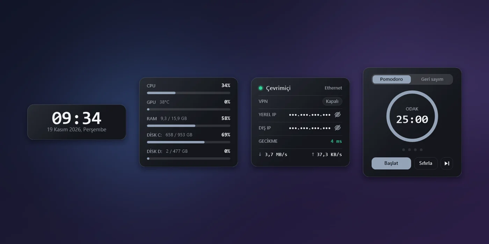
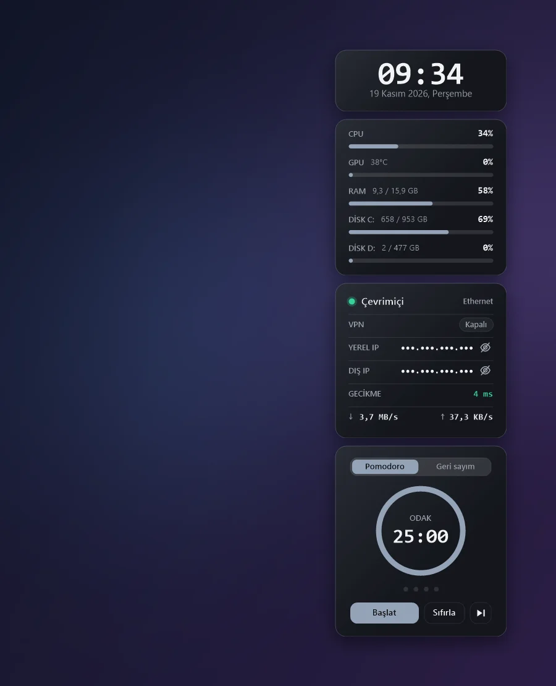
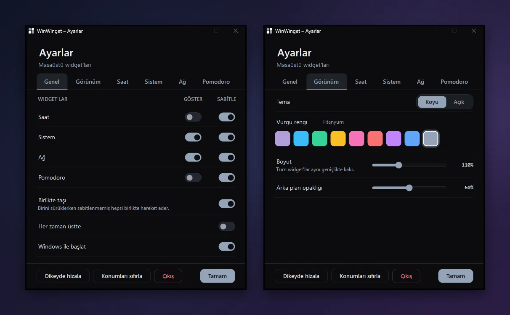

# WinWinget

**Windows masaüstü için hafif widget'lar — saat, sistem, ağ ve Pomodoro tek uygulamada.**

[**İndir**](https://github.com/KaanHaciomeroglu/WinWinget/releases/latest) · [Özellikler](#özellikler) · [Kurulum](#kurulum)

## Özellikler

Tek `.exe`, tek süreç, sistem tepsisinde tek simge ve tek ayar penceresi. Widget'lar aynı genişlikte, tek sütun halinde dizilir.

| Widget | Ne gösterir |
| --- | --- |
| **Saat** | Saat ve tarih; 12/24 saat, saniye ve farklı tarih biçimleri |
| **Sistem** | CPU, GPU (NVIDIA'da sıcaklıkla), RAM ve seçilen disklerin doluluğu |
| **Ağ** | Bağlantı ve VPN durumu, yerel/dış IP (tek tıkla gizlenebilir), ping, anlık hız |
| **Pomodoro** | Halka sayaçlı Pomodoro ve geri sayım, sesli uyarı ve Windows bildirimi |

- **Sabitle:** Sabitlenen widget tıklamaları alttaki pencereye geçirir, yanlışlıkla sürüklenmez.
- **Birlikte taşı / Dikeyde hizala:** Widget'ları birlikte sürükle ya da tek tıkla sütuna topla.
- **Ev monitörü:** Çok monitörde widget'lar en son taşıdığın ekranda kalır.
- **Görünüm:** Koyu/açık tema, 9 vurgu rengi, boyut ve opaklık — tüm widget'lara birlikte uygulanır.
- **Hafif:** ~14 MB bellek, tek çekirdeğin ~%0,3'ü. Gizli widget'lar ve çalışmayan Pomodoro hiç zamanlayıcı kullanmaz.

  
  

## Kurulum

1. [Releases](https://github.com/KaanHaciomeroglu/WinWinget/releases/latest) sayfasından `WinWinget.exe`'yi indir.
2. Çalıştır — kurulum gerekmez, Windows'taki .NET Framework yeterli.
3. Ayarlar için sistem tepsisindeki simgeye tıkla. **Windows ile başlat** seçeneğiyle açılışta otomatik çalışır.

Ayarlar `%APPDATA%\WinWinget\` altında düz metin dosyalarında tutulur.
